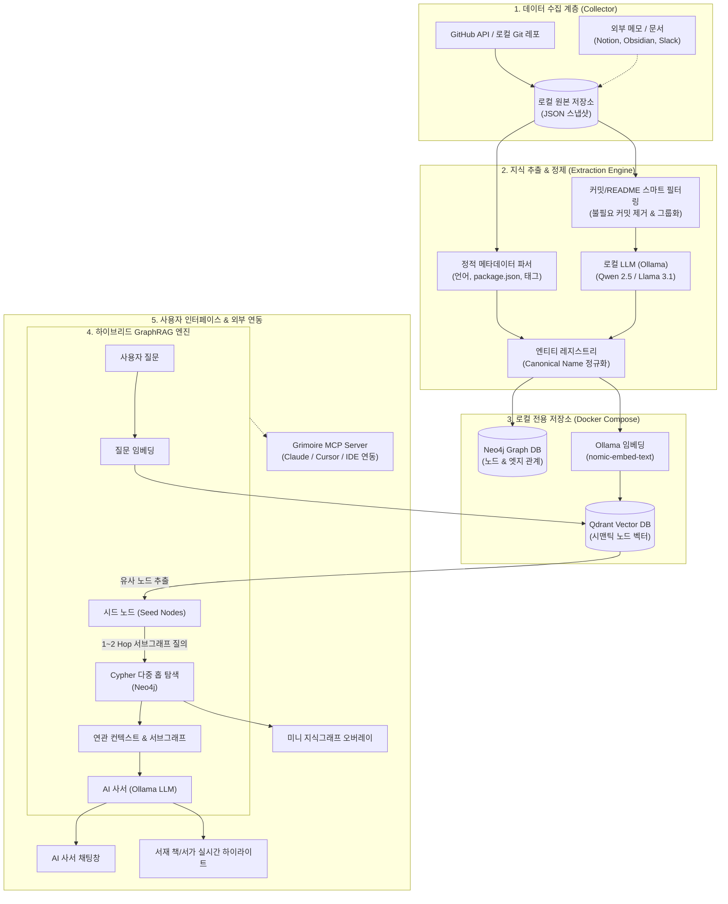
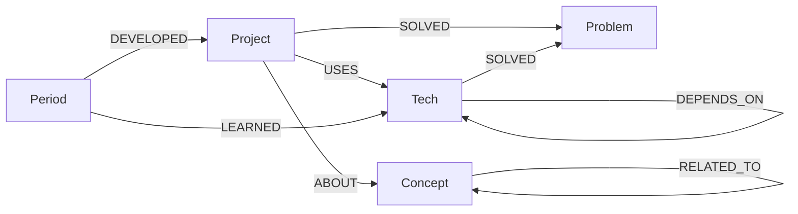
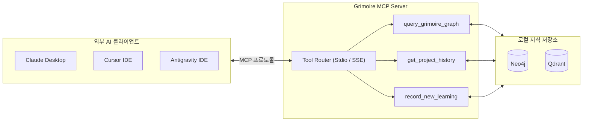

# Grimoire: 로컬 프라이빗 AI 지식그래프 & 세컨드 브레인 구축 설계서

> **핵심 가치**: 외부 데이터 유출 0% (100% 로컬 구동), API 비용 0원, 커밋·레포지토리 히스토리가 살아 숨쉬는 **지식그래프 기반 AI 사서(Librarian) 시스템**.

---

## 1. 시스템 전체 아키텍처 (100% Local Privacy Stack)



---

## 2. 지식그래프 온톨로지(Schema) 설계

### 2.1 노드(Node) 타입 정의

| 노드 레이블 (`Label`) | 설명 | 주요 속성 (`Properties`) |
|---|---|---|
| `Project` | 레포지토리 (책 한 권) | `id`, `name`, `fullName`, `isPrivate`, `primaryLang`, `stars`, `lastPushedAt` |
| `Tech` | 사용된 프레임워크/라이브러리/도구 | `id` (정규화 ID), `name` (표준명), `category` (frontend/backend/db 등) |
| `Concept` | 다루는 도메인 개념/아키텍처/기능 | `id`, `name`, `summary`, `domain` (auth, ai, realtime, state 등) |
| `Problem` | 해결한 주요 문제/버그/도전과제 | `id`, `title`, `description`, `solutionSummary` |
| `Period` | 개발 시기 (연도/분기/월) | `id` (e.g. `2024-Q1`), `year`, `quarter` |

### 2.2 엣지(Edge) 관계 정의



- `(:Project)-[:USES {weight, source}]->(:Tech)`
- `(:Project)-[:ABOUT {confidence}]->(:Concept)`
- `(:Project)-[:SOLVED]->(:Problem)`
- `(:Period)-[:LEARNED {firstCommitDate}]->(:Tech)`: 개발자가 해당 기술을 **처음 습득하고 사용한 시점** 추적
- `(:Concept)-[:RELATED_TO {strength}]->(:Concept)`: 지식 간의 횡적 연결망 형성

---

## 3. 100% 로컬 인프라 구성 (`docker-compose.yml`)

외부 API나 클라우드 결제 없이 로컬에서 완결되는 전용 DB 스택입니다.

```yaml
version: "3.8"

services:
  # 1. 그래프 데이터베이스: Neo4j Community
  neo4j:
    image: neo4j:5.26-community
    container_name: grimoire-neo4j
    restart: unless-stopped
    ports:
      - "7474:7474" # HTTP 브라우저
      - "7687:7687" # Bolt 프로토콜
    environment:
      - NEO4J_AUTH=neo4j/grimoire_pass123
      - NEO4J_PLUGINS=["apoc"]
    volumes:
      - ./data/neo4j/data:/data
      - ./data/neo4j/logs:/logs
      - ./data/neo4j/import:/var/lib/neo4j/import

  # 2. 벡터 데이터베이스: Qdrant
  qdrant:
    image: qdrant/qdrant:v1.12.1
    container_name: grimoire-qdrant
    restart: unless-stopped
    ports:
      - "6333:6333" # REST API & Dashboard
      - "6334:6334" # gRPC
    volumes:
      - ./data/qdrant/storage:/qdrant/storage
```

> **Ollama 로컬 설치 및 모델 준비**:
> ```bash
> # LLM 모델 (한국어/코딩에 강한 Qwen 2.5 7B/14B 또는 Llama 3.1)
> ollama pull qwen2.5:7b-instruct
> 
> # 임베딩 모델 (고성능 로컬 임베딩)
> ollama pull nomic-embed-text
> ```

---

## 4. 지식 추출 및 엔티티 정규화 파이프라인

### 4.1 단계별 추출 흐름

1. **1단계: 결정론적 정적 분석 (비용 0, 즉시 수행)**
   - `package.json`, `go.mod`, `Cargo.toml`, `requirements.txt` 등에서 의존성 패키지 파싱 → `Tech` 노드 및 `[:USES]` 엣지 생성.
   - GitHub Language Statistics에서 `primaryLang` 산출.
2. **2단계: 커밋 로그 사전 압축 및 스마트 필터링**
   - 불필요한 커밋(단순 오타 수정, docs 업데이트, merge commit) 제외.
   - 주요 `feat`, `fix`, `refactor` 커밋을 기능별/기간별로 묶어 LLM에 전달할 컨텍스트 최소화.
3. **3단계: Ollama Structured JSON Extraction**
   - LLM에게 엄격한 JSON Schema를 제시하여 도메인 개념(`Concept`), 해결 문제(`Problem`), 학습 시점(`Learned`)을 추출.
4. **4단계: Canonical Entity Resolution**
   - 예: `["react", "react.js", "ReactJS"]` → `tech-react` 표준 ID로 일원화.
   - 정규화 사전에 없는 신규 개념은 임베딩 코사인 유사도(>0.88)로 기존 노드와 자동 매칭.

### 4.2 LLM 추출 프롬프트 템플릿 예시

```json
{
  "system": "당신은 개발자의 깃허브 이력을 분석해 지식그래프를 구축하는 AI 아키텍트입니다. 주어진 레포지토리 정보와 커밋 내역에서 핵심 기술(Tech), 도메인 개념(Concept), 해결한 문제(Problem)를 정밀 추출하여 정해진 JSON 포맷으로만 응답하세요.",
  "format": {
    "concepts": [{"name": "실시간 데이터 동기화", "domain": "realtime", "summary": "WebSocket 기반 양방향 통신 구현"}],
    "problems_solved": [{"title": "커밋 폭증 시 메모리 누수 방지", "tech_used": ["RxJS", "Redis"]}],
    "learned_tech": [{"name": "Neo4j", "first_applied_date": "2024-03"}]
  }
}
```

---

## 5. 하이브리드 GraphRAG 검색 메커니즘

AI 사서가 질문을 받았을 때 정확하고 풍부한 맥락을 조합하는 3단계 검색 방식:

```
[사용자 질문: "내가 분산 락이나 동시성 이슈를 다뤘던 프로젝트랑 그때 쓴 기술 알려줘"]
   │
   ▼
1. Qdrant 시맨틱 벡터 검색
   - 질문 임베딩과 가장 유사한 Concept 노드 / Problem 노드 Top-K(예: 3개) 탐색
   - 예: "동시성 제어", "분산 락 (Redis Redlock)"
   │
   ▼
2. Neo4j Cypher 2-Hop 서브그래프 쿼리
   - MATCH (c:Concept)-[r1]-(p:Project)-[r2:USES]->(t:Tech)
     WHERE c.id IN $seedConceptIds
     RETURN p.name, p.primaryLang, collect(t.name) as technologies, c.summary
   │
   ▼
3. Ollama AI 사서 컨텍스트 합성 및 응답
   - 서브그래프 경로(프로젝트 ↔ 기술 ↔ 해결한 문제)를 프롬프트에 주입
   - "서고 3번 구역의 [Grimoire-Core] 마법서를 확인했습니다. 해당 프로젝트에서 Redis 분산 락을 통해 커밋 수집 시 동시성 충돌을 해결하셨습니다..."
```

---

## 6. 인터랙티브 UI 연동 및 시각화

- **2D 마법 서재**:
  - 서가(Bookshelf): 주 언어/도메인별로 분류된 2D 픽셀/아이소메트릭 서가.
  - 책(Book): 레포지토리 하나에 대응. AI 사서가 응답에서 언급한 책이 서가에서 금빛으로 은은하게 발광(Glow Effect).
- **미니 지식그래프 팝업 (Force Graph)**:
  - 서재에서 특정 책을 꺼내거나 사서 채팅에서 링크를 누르면, 해당 프로젝트를 중심으로 연결된 기술/개념 노드가 동적으로 펼쳐지는 인터랙티브 네트워크 시각화(React-Force-Graph / D3).

---

## 7. 시스템 권장 사양 가이드 (Hardware Requirements)

| 구분 | **최소 사양** (구동 가능) | **권장 사양** (실시간 사서 대화) | **고사양 / 개발용** (대규모 레포/14B 모델) |
|---|---|---|---|
| **CPU** | 4코어 8스레드 (i5 / Ryzen 5) | 6~8코어 (i7 / Ryzen 7, Apple M2/M3) | 8코어 이상 (i9 / Ryzen 9 / M3 Max) |
| **GPU** | 내장 그래픽 (CPU 연산 모드) | **NVIDIA VRAM 8GB+** (RTX 3060/4060) | **NVIDIA VRAM 12GB~16GB+** (RTX 4070Ti+) |
| **RAM** | **16 GB** | **16 GB ~ 32 GB** | **32 GB+** |
| **저장공간** | SSD 20 GB 이상 | **NVMe SSD 30 GB 이상** | NVMe SSD 50 GB 이상 |
| **OS** | Windows 10/11 (WSL2), macOS, Linux | Windows 11 (WSL2), macOS, Linux | Linux / macOS / Windows 11 |

### 리소스 점유량
- **Ollama LLM (`qwen2.5:7b` / `llama3.1:8b`)**: ~4.5GB ~ 5.5GB (VRAM 또는 RAM)
- **임베딩 모델 (`nomic-embed-text`)**: ~300MB
- **Neo4j Graph DB (Docker)**: ~1GB ~ 2GB
- **Qdrant Vector DB (Docker)**: ~300MB ~ 500MB
- **Next.js 서재 웹 앱**: ~500MB

> 💡 **저사양(RAM 8GB~16GB 미만) 환경 최적화**:
> `ollama pull qwen2.5:3b` 모델(메모리 2GB 미만 점유)로 교체하여 경량 구동 가능.

---

## 8. MCP (Model Context Protocol) 및 외부 API 연동 아키텍처

지식그래프를 **MCP Server**로 노출하여 Claude Desktop, Cursor, Antigravity IDE 등 외부 AI 도구들이 내 세컨드 브레인을 직접 쿼리하도록 연동합니다.



### 8.1 MCP 서버 제공 도구(Tools)

1. `query_grimoire_graph`: 자연어 또는 기술명으로 연관 서브그래프(프로젝트, 기술, 해결한 문제) 질의
2. `get_project_history`: 특정 프로젝트(책)의 커밋 연혁, 기술 스택, 핵심 아키텍처 상세 조회
3. `record_new_learning`: 외부 AI와 대화 중 새롭게 습득한 지식을 지식그래프 노드로 즉시 추가

### 8.2 MCP 서버 구현 예시 (`src/lib/mcp/server.ts`)

```typescript
import { Server } from "@modelcontextprotocol/sdk/server/index.js";
import { StdioServerTransport } from "@modelcontextprotocol/sdk/server/stdio.js";
import { CallToolRequestSchema, ListToolsRequestSchema } from "@modelcontextprotocol/sdk/types.js";

const server = new Server(
  { name: "grimoire-knowledge-graph", version: "1.0.0" },
  { capabilities: { tools: {} } }
);

server.setRequestHandler(ListToolsRequestSchema, async () => ({
  tools: [
    {
      name: "query_grimoire_graph",
      description: "개발자의 과거 커밋, 기술 스택, 문제해결 이력 지식그래프를 검색합니다.",
      inputSchema: {
        type: "object",
        properties: {
          query: { type: "string", description: "검색할 기술/도메인 키워드" }
        },
        required: ["query"]
      }
    }
  ]
}));

server.setRequestHandler(CallToolRequestSchema, async (request) => {
  if (request.params.name === "query_grimoire_graph") {
    const query = String(request.params.arguments?.query);
    // GraphRAG 검색 로직 호출
    const results = await searchKnowledgeGraph(query);
    return { content: [{ type: "text", text: JSON.stringify(results, null, 2) }] };
  }
  throw new Error("Tool not found");
});

const transport = new StdioServerTransport();
await server.connect(transport);
```

### 8.3 외부 데이터 소스 확장 파이프라인

| 외부 소스 | 연결 프로토콜 | 지식그래프 반영 방식 |
|---|---|---|
| **Obsidian / Markdown** | 로컬 파일시스템 와처 (chokidar) | `(:Note)-[:REFERENCES]->(:Concept)` |
| **Notion / Slack** | REST Webhook / Notion API | `(:Doc)-[:ABOUT]->(:Project)` |
| **Jira / GitHub Issues** | GitHub / Jira Webhook | `(:Issue)-[:RESOLVED_IN]->(:Project)` |
